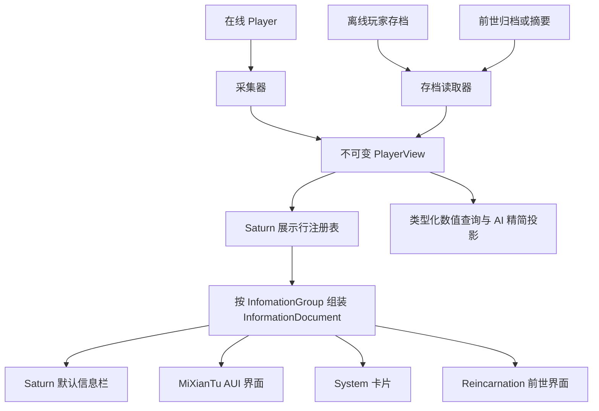

# Saturn 玩家视图与信息栏接口设计

> 状态：Saturn 的基础视图解析、展示行/InfomationGroup 注册、按组与全取、Codec 和默认文字页面已实现；Reincarnation 已接入归档快照与前世查看，见 [接入实现](09-Saturn玩家视图接入与前世界面.md)。MiXianTu/System 业务迁移和增强外观预览待实现。实际接口见 [Saturn 玩家视图 API](../../../Saturn/docs/PLAYER-VIEWS.md)，下文保留完整设计目标。依据 Saturn、MiXianTu、Reincarnation 以及 System `master` 源码核对；System 使用 Minecraft 26.1.2 与外部 Saturn 依赖。
> 后续实现：Saturn 内置信息行已迁移为数据包定义，由 Group 的 rows（Either Holder/Tag）引用独立 Row，支持多组复用及组合式表达式；Java provider 作为兼容入口保留。详见 [数据驱动重构](10-Saturn信息行数据驱动重构.md)，下文单组描述为原始设计阶段内容。
> 字段层后续实现：字段注册到 `saturn:player_view_field`，Contributor 与 SavedReader 合并到各字段，详见 [逐字段解析](11-Saturn字段注册表与逐字段解析.md)。下文独立采集器/读取器描述保留为设计记录，当前扩展方式以 Saturn API 文档为准。
> 目标：让实时玩家、离线存档、前世归档共用一套玩家信息接口，并服务于 Saturn 通用信息栏、觅仙途信息界面、System 玩家卡片和前世查看。

**实现边界：Saturn 只根据调用方传入的数据解析和展示。** 存档文件定位/读取、前世归档保存、权限和网络同步归宿主负责；Saturn 的快照为内存只读模型，Codec 只做编解码。InfomationGroup 主要服务 MXT 等前端分栏，明确同时提供 `collect(view, group)` 与 `collectAll(view)`；全取结果仍保留每行 InfomationGroup。

## 1. 推荐结论

**采用不可变 `PlayerView` + 模组数据扩展 + Saturn 按行注册的展示扩展。** 玩家信息的读取和展示不以还原 `Player` 为前提。展示行统一由 Saturn 管理，注册每行时必须传入 `InfomationGroup`。

每个模组向 Saturn 注册自己拥有的数据字段、采集器及各条展示行。每条展示行只有一份注册，三个使用方按 `InfomationGroup` 选取内容，只负责布局、交互和接入查询通道，不分别适配每种附件或重新计算玩法数据。



这里有两层通用性：

- `PlayerView` 解决“这个对象有哪些已知玩家信息”，供界面、卡片和其他程序读取。
- Saturn 的展示行注册表解决“谁提供哪一行、归属哪个 InfomationGroup、顺序如何”，`InformationDocument` 保存组装结果，让未知业务模组的数据也能进入通用信息栏。

仅有 `PlayerView` 而让三个界面各自认识所有扩展类型，仍会产生重复兼容；仅有格式化字符串，又会丢失数值、未知状态和程序查询能力。因此两层都需要，但事实数据只采集一次。

## 2. 现有代码对设计的约束

### 2.1 觅仙途

`InformationCollector` 直接持有 `Player`，并通过 `getData` 读取可变附件。`InformationManager` 中既有普通数值读取，也有境界、突破条件、寿命、诅咒等计算。

`InformationPanelScreen` 还在信息收集器之外，直接读取当前玩家的功法、装备，并渲染 `minecraft.player`。因此只替换 `InformationCollector` 的参数不够，功法表、装备栏和模型预览也要改为读取同一个视图。

下列数据必须保持原有业务语义：

| 内容 | 应采集的数据 | 不能采用的替代方式 |
| --- | --- | --- |
| 境界、小境界 | 链 ID、境界 ID、当时算出的小境界与展示回退 | 用今天的数据包重新推导当年的境界 |
| 突破条件 | 当时的进度、阈值、条件结果；未评估要明确表示 | 把前世数据送进当前玩家的条件判断 |
| 寿命 | 剩余/总 tick、是否计入寿命、当时的每年 tick 数 | 把未知值或未计入寿命当作 0 |
| 灵根、体质 | 所持身份、启用状态、元素、品质、重复数量 | 只保存最后拼接出的一个名字 |
| 功法 | 等级、熟练度、当前/下一阶段阈值、是否满级 | 在每个界面复制 `TechniqueProgress` 的算法 |
| 诅咒 | 层数、来源、永久/限时状态、捕获时剩余 tick、显示判定 | 打开前世界面时用当前 gameTime 继续扣时间 |

### 2.2 System master

`PlayerSnapshotOutput` 已有健康、经验、维度等类型化字段，卡片通过 `buildCard()` 提供平面绑定。`PlayerQueryTool` 经有界主线程队列采集数据，这个线程安排需要保留。

`PlayerModelElement` 已采用独立 `EntityRenderState`，渲染时不修改真实玩家姿态，可以沿用这种思路；但数据源仍是“按 UUID 查找当前实体”。历史记录不能沿用这种查找，否则同一个 UUID 的前世卡片会展示今世装备。

`SignInDecision.Player.of(PlayerSnapshotOutput)` 也依赖现有输出。接入视图应保留它的精简投影以及旧卡片数据的读取能力。

在线玩家列表属于查询时的世界上下文，`language` 属于请求者偏好或明确采集的客户端设置；它们不应成为每一份历史 `PlayerView` 的必填玩家事实。

### 2.3 Saturn

Saturn 目前没有玩家视图模块，也没有 AUI 依赖。`api` 放契约，具体模型、服务和界面实现在自己的模块包中。

现有 `PlayerNameQuery` 明确采用“Saturn 不自行发送数据包，由使用方安装查询通道”的方式。玩家视图延续这个边界，提供查询契约、编解码和服务端采集能力，由宿主模组负责实际传输。

`ResourceHolderAttachment` 已保存资源值和 `audit` 中的上下限快照。这些值可用于只读展示，但它们表示运行时上次结算的边界，不自动等于捕获瞬间重新求值的边界。视图要保留来源和结算 tick，不能无标记混用。

### 2.4 Reincarnation

`history/<uuid>/<generation>.dat` 保存的是 `SoulRecord` 摘要；完整玩家 NBT、统计、进度、附件、处理器快照在 `transactions/<txId>/archive.dat`。应通过摘要的事务 ID、事务清单和 `LifeStore.archive(tx)` 校验后读取，不能把历史摘要当作完整玩家存档。

`keep_on_rebirth` 决定哪些附件进入新世。前世原始玩家 NBT 仍包含当时可序列化的附件，历史查看不能拿继承白名单再次过滤前世内容。

## 3. `PlayerView` 的核心契约

### 3.1 不可变、可缺失、可扩展

推荐把 `PlayerView` 定义成“某个时点、某个来源的只读玩家信息”，采用类型化字段访问。基础字段有稳定入口，第三方无需向接口不断添加方法。

以下是拟议签名，关联模型和注册器仍需实现，不是当前已有 API：

```java
public interface PlayerView {
    PlayerViewMeta meta();

    <T> ViewValue<T> read(PlayerViewField<T> field);
}

public interface PlayerViewField<T> {
    Identifier id();

    int schemaVersion();

    Codec<T> codec();
}

public sealed interface ViewValue<T> permits KnownValue, MissingValue {
}
```

`KnownValue<T>` 和 `MissingValue<T>` 是不可变模型，分别携带：

| 模型 | 内容 |
| --- | --- |
| `KnownValue<T>` | `T value`、`ValueOrigin origin` |
| `MissingValue<T>` | `MissingReason reason` |

`ValueOrigin` 至少区分 `CAPTURED`、`SAVED`、`RECONSTRUCTED`。保存的运行时结算快照可以带原结算 tick；根据当前定义重新推导的旧数据必须标为 `RECONSTRUCTED`。

`MissingReason` 至少包括：

| 状态 | 含义 | 默认显示 |
| --- | --- | --- |
| `NOT_CAPTURED` | 旧记录未保存该项 | 未记录 |
| `NOT_REQUESTED` | 本次没有请求该组数据 | 按需加载或不显示 |
| `UNSUPPORTED` | 当前数据源/读取器不支持 | 不支持 |
| `REDACTED` | 已确认可见的记录中，该项未获授权 | 无权限或隐藏 |
| `INVALID` | 该字段内容损坏、版本无法读取或采集失败 | 数据不可用 |
| `NOT_APPLICABLE` | 对该对象没有这个概念 | 不适用或隐藏 |

是否允许透露记录存在，由查询权限层决定；不能用字段状态泄露本不该被查询到的历史。

明确区分三件事：`KnownValue(0)` 是已知为零；`KnownValue(List.of())` 是已知为空；`MissingValue` 是不知道。界面不得用 0、空背包、凡人或无诅咒代替未知。

字段可以是数值，也可以是一个不可变业务 DTO，例如 `List<TechniqueView>`。不要把每一种灵根、每一门功法都注册成新的 Java 字段；这些属于一个字段内按定义 ID 索引的数据。

### 3.2 身份和记录引用

```java
public record PlayerViewRef(
        UUID accountId,
        Identifier source,
        String recordId
) {
}
```

示例：

- 当前玩家：`source = saturn:current`，`recordId = current`。
- 离线存档：`source = saturn:saved`，`recordId` 由存档数据源确定。
- 前世：`source = reincarnation:life`，`recordId` 为持久、可校验的内部世代标识。

`recordId` 是受限长度的逻辑 ID，不是任意磁盘路径。数据源必须自行解析并校验账号、记录与事务的对应关系。

Saturn 不把世代写进核心接口，由 Reincarnation 的 `LifeView` 扩展表达。内部世代继续按现有规则存储，界面统一复用 `LifeNumbers` 展示“第一世”，不由各个界面各加一次偏移。

这里也不应使用 `EntityReference` 代替 `PlayerViewRef`：前者负责当前世界实体的解析和旧世关系失效，历史查询需要的恰恰是访问已失效旧世的记录，两者用途不同。

`PlayerViewMeta` 建议包含：

- `ref`、`snapshotId`：区分账号/记录，以及同一记录的不同捕获版本。
- `sourceKind`：实时捕获、离线存档、归档、仅摘要。
- `capturedAt`、可选的 `capturedGameTime`：源数据确实记录的时间；不知道就留空。
- `assembledAt`：本次读取/组装时间，不能冒充历史捕获时间。
- 数据格式版本、采集器版本；规则相关字段可另带规则版本或定义指纹。

连接/存档上下文由查询服务持有。客户端缓存以“当前连接 + `PlayerViewRef` + 快照标识”区分，断开连接清空，不能只按 UUID 缓存。

### 3.3 不暴露可变玩家入口

`PlayerView` 不提供 `getPlayer()`、`level()`、`getData(AttachmentType<T>)`、传送、背包写入等入口。界面读一个视图时，不需要判断它背后是否真的有 Player。

`LivePlayerViewContext` 可以给受信任的采集器提供真实玩家；它不传入信息展示器，也不进入客户端快照。原始 NBT 只供存档读取器使用，不成为普通界面的兼容接口。

即使数据来自在线玩家，`PlayerView` 也应是不可变快照。刷新时重新采集并替换，避免不同 getter 读到不同 tick 的数据，或“快照”实际上继续引用活玩家。

不可变要求落实到内容：集合深复制；不暴露可变附件、`Holder`、原始 NBT、可改的 `ItemStack` 和 `MutableComponent`。物品模型内部持有副本，渲染取用时返回副本；组件同样防止调用方修改内部内容。

## 4. 标准字段与模组扩展

### 4.1 Saturn 的标准字段

使用 `PlayerViewFields` 提供类型化常量。基础调用例如：

```java
ViewValue<Float> health = view.read(PlayerViewFields.HEALTH);
ViewValue<Float> maximum = view.read(PlayerViewFields.MAX_HEALTH);
ViewValue<ExperienceView> experience = view.read(PlayerViewFields.EXPERIENCE);
```

健康和最大健康分开，允许“旧档保存了健康，但无法确定当时有效最大健康”。聚合 DTO 的成员也需要在可能部分缺失时保留相同语义。

| 组 | 建议字段 | 备注 |
| --- | --- | --- |
| 身份 | `PROFILE` | 捕获时姓名、显示名、可选档案属性；UUID 由元数据保证 |
| 生存 | `HEALTH`、`MAX_HEALTH`、`ABSORPTION`、`FOOD`、`AIR` | 数值与单位独立，不只存格式化文本 |
| 经验 | `EXPERIENCE` | level、total、进度 |
| 位置 | `LOCATION` | 维度 ID、坐标、朝向；由权限决定可见程度 |
| 状态 | `GAME_MODE`、`EFFECTS`、`ATTRIBUTES` | 属性分清基值、保存的修饰符、已知有效值 |
| 装备 | `EQUIPMENT`、`APPEARANCE` | 主副手、护甲、外观；缺失模型不影响文本 |
| 容器 | `INVENTORY`、`ENDER_CHEST`、`CARRIED_ITEM` | 可选详情；准确保留槽位，不能只存物品总数 |
| 进度 | `STATISTICS`、`ADVANCEMENTS` | 可选详情、分页或分组请求；不随每次生命值刷新全量发送 |
| 社会 | `SCORES`、`TEAM` | 已保存的个人信息；队伍名不代表历史队伍全部规则 |
| Saturn | `RESOURCES`、`ABILITIES` | 由 Saturn 自己的采集器支持，不暴露附件本体 |

“完整信息栏”表示有完整的扩展和缺失处理能力，不要求第一次打开就读取、发送全部背包、统计和进度。界面按基础、状态、装备、详细进度等组请求数据。

### 4.2 业务模组的字段

| 模组 | 字段示例 | 模组负责的语义 |
| --- | --- | --- |
| MiXianTu | `mxt:cultivation`、`mxt:lifespan`、`mxt:spirit_identity`、`mxt:techniques`、`mxt:curses` | 境界链、寿命单位、根骨身份、功法进度、诅咒显示规则 |
| Reincarnation | `reincarnation:life` | 内部世代、始末时间、转生原因、归档完整程度 |
| 其他模组 | 自有命名空间的字段 | 魔力、职业、技能、装备扩展等 |

DTO 中引用数据包定义时，保存“定义 ID + 显示文本回退 + 必要的已解析数值”，而不是运行时 Holder。定义被删除后，至少能显示捕获时的文本或 ID，单个缺失定义不应导致整份视图无法加载。

不要把觅仙途的境界、五行、功法规则移入 Saturn；Saturn 提供载体、扩展点和通用展示能力。

## 5. 模组只注册一次的扩展方式

### 5.1 数据采集与展示行注册分开

建议提供以下契约，具体名称可在实现时按现有包风格收敛：

```java
public interface PlayerViewContributor {
    Identifier id();

    Set<PlayerViewField<?>> fields();

    void capture(LivePlayerViewContext context, PlayerViewWriter writer);
}

public interface SavedPlayerViewReader {
    Identifier id();

    void read(SavedPlayerViewContext context, PlayerViewWriter writer);
}

```

这里 `capture` 为新快照采集，`read` 用于没有新视图快照的存档/旧归档兼容。不要求只有实时字段的扩展必须支持旧档读取。

展示接口采用第 6 节的逐行注册，不能仅注册一个可任意追加区块的模块回调。注册可以由同一个模块安装函数一次完成：字段、采集器、可选旧档读取器、InfomationGroup 和各条展示行。所有注册都进入 Saturn，不按 UI 或归档消费者重复注册。

字段注册器检查重复 ID 和 schema 一致性；写入器校验字段归属、类型、有限数值，并拒绝一个采集器覆写另一个采集器的字段。注册顺序不能决定同名字段谁获胜。

### 5.2 数据源和存档读取器的边界

数据源只负责取得可信输入和元数据：在线实体、离线保存文件、历史事务归档或摘要。存档读取器负责把输入转换成模块字段。

Saturn 的 `SavedPlayerViewContext` 提供标准化的可选输入：玩家 NBT、统计、进度、捕获时间和版本信息。Reincarnation 将自己的归档封套映射到这些输入，同时注册生命周期扩展。Saturn 不直接认识 `transactions/<txId>`，MiXianTu 也不需要导入 Reincarnation 类。

优先级固定为：**已保存的视图字段 → 可验证的原始保存值 → 明确标记的重建值 → 缺失**。旧档读取器只补缺项，不覆盖捕获时已保存的结果。

普通附件不会自动获得完整的历史展示能力。附件 Codec 解决序列化，不包含字段含义、读权限、公式上下文和界面布局。应由附件所属模组提供一次扩展；必要时 Saturn 可提供读取已有序列化附件的辅助工具，但不尝试在假 Player 上初始化全部附件。

### 5.3 采集必须只读

- 服务端实体数据在主线程采集；只把复制完的独立数据交给异步编码或磁盘任务。
- 附件读取优先 `getExistingData`。若不存在，由所属模块根据语义输出“已知默认值/已知为空/未记录”，不得调用 `getData` 给活玩家新建附件来填界面。
- 不调用资源初始化、rebind、加点、突破、能力赋予等操作；不为了展示推进 RNG 或触发玩法事件。
- 计算复用模块已有的只读查询或运行时已解析结果。若现有服务混合读取与写入，先抽出共享的只读查询，不能在 Saturn 另写一份算法。
- 某公式依赖随机或不可重现上下文时，优先使用已保存的结算结果；没有可安全取得的结果就标缺失，不能声称“只读采集”同时改变随机序列。
- 采集器异常只影响它拥有的字段并记录诊断。捕获成功字段不因另一个可选扩展失败而全部丢弃；原有转生事务所需的强制快照校验仍独立执行。

## 6. 通用信息栏的展示接口

### 6.1 Saturn 的展示行注册表与 InfomationGroup

展示扩展本身就是 Saturn 的公共扩展点。模组将每一条逻辑展示行注册到 Saturn，注册参数显式包含 `InfomationGroup`，不由界面推断，也不从字段命名空间猜分组。

当前对外入口如下，`PlayerInformation` 和注册器直接位于 Saturn 的 `com.iafenvoy.saturn.view`，`InfomationGroup` 和行内容位于 `com.iafenvoy.saturn.view.model`：

```java
public interface PlayerInformationRowProvider {
    Optional<InformationRowContent> collect(
            PlayerView view, InformationContext context);
}

public final class PlayerInformation {
    public static InfomationGroup registerGroup(
            Identifier id, Component title, int order);

    public static void register(
            Identifier rowId, InfomationGroup group, int order,
            PlayerInformationRowProvider provider);

    public static void register(
            Identifier rowId, InfomationGroup group, int order, int importance,
            PlayerInformationRowProvider provider);

    public static InformationDocument collect(
            PlayerView view, InformationContext context,
            Set<InfomationGroup> groups);

    public static InformationDocument collect(
            PlayerView view, InfomationGroup group);

    public static InformationDocument collectAll(PlayerView view);
}
```

以上为当前接口的主要签名，省略方法体；另有显式传入 `InformationContext` 的重载。`PlayerInformation` 属于实现入口，不放进只收契约的 `api` 包。

例如 MiXianTu 注册自己的分组，再逐行登记展示逻辑：

```java
import com.iafenvoy.saturn.view.PlayerInformation;
import com.iafenvoy.saturn.view.model.InfomationGroup;

InfomationGroup cultivation = PlayerInformation.registerGroup(
        Identifier.parse("mxt:cultivation"),
        Component.translatable("info.mxt.cultivation"), 100);

PlayerInformation.register(Identifier.parse("mxt:realm"),
        cultivation, 0, MxtInformationRows::realm);
PlayerInformation.register(Identifier.parse("mxt:lifespan"),
        cultivation, 10, MxtInformationRows::lifespan);
PlayerInformation.register(Identifier.parse("mxt:spirit_roots"),
        cultivation, 20, MxtInformationRows::spiritRoots);
```

Saturn 的注册方法已实现；示例中的 MXT 展示器及新增翻译键仍待业务接入时实现，并同时补全中英文翻译。

规则固定为：

- **按行注册和管理**：注册表的最小单位是 `rowId`。每条注册生成零或一条逻辑行，不能由一个模块回调任意写入其他行或区块。
- **分组必填**：`InfomationGroup` 是可扩展、具有稳定 ID 的注册模型，不使用只有 `BASIC/CULTIVATION` 的封闭枚举。Saturn 提供基础分组，模组可以注册新分组，也可以把新行加入已有分组。
- 分组保存 ID、标题和排序；行保存 ID、所属分组、排序和 provider。分组和行的重复 ID 一律拒绝，不允许后注册者覆盖前者。分组应先于所属行注册。
- 行 ID、分组、排序和重要程度由注册器持有，provider 只返回 `InformationRowContent`，不能根据数据源偷偷换组或覆盖其他行的 ID。
- `importance` 为 int，默认 `0`，越大越重要；旧注册重载和缺少此键的文档保持默认值。前端可通过 `document.withMinimumImportance(minimum)` 保留不低于阈值的行，保持原有排序；默认收集仍返回全部行。
- 组间按分组 order、分组 ID 排序；组内按行 order、rowId 排序。标题和翻译不参与身份比较。
- `Optional.empty()` 表示按业务规则不展示该行；需要说明未记录/不可用时返回带 `Missing` 的行内容，不能把缺数据自动当成隐藏。
- 一条逻辑行可以含有列表、物品或表格值，渲染器可以展开成多条视觉行。动态功法、灵根、多条修炼链用带稳定元素 ID 的集合表达，不随每份视图动态改全局注册表。
- 单行 provider 失败只影响该行；同组其他行继续生成。空组默认不显示。
- 所有前端从同一个 Saturn 注册表按分组/行 ID 收集，不能在 MiXianTu、System、Reincarnation 再建立各自的展示扩展注册表。

`collect` 的分组集合为明确的查询范围；全取使用 `collectAll`，不让空集合同时承担“全部”和“没有”的两种含义。`InformationDocument.rows()` 取得全部有序行，`rows(InfomationGroup)` 对已有文档筛选，`groups()` 列出文档中出现的分组。

### 6.2 `InformationDocument`

信息文档保存纯展示模型，不包含 AUI 元素、Minecraft `Screen` 实例或业务 Player 引用。

建议最小模型：

```text
InformationDocument
  rows: List<InformationRow>

InformationRow
  id, group, order, importance, content

InformationRowContent
  label, value, tooltip, tone, sourceFields

InformationValue
  Text | Number | Boolean | Meter | Items | List | Table | Missing
```

`InformationDocument` 按注册信息组装为完整有序的平面行列表，每行保留原始 `InfomationGroup`、行 ID 和顺序；既能全取，也能按分组取。前端可以把分组映射成栏、页签或折叠区块。`sourceFields` 记录展示内容来自哪些字段，供权限过滤、诊断和历史展示回退使用。分组、行及动态集合元素都有稳定 ID，不能用翻译后的名字作 key。

`Meter` 保留 current、上下界、单位与有效状态；原始数值不因进度条夹到 `[0, 1]` 而被改写。满级、不适用、未知阈值要用显式状态，不把 NaN 或 Infinity 放入共享 JSON/NBT DTO。

`Table` 保留列 ID、类型和行 ID，足以表达功法页。三个前端可以采用不同列宽和布局，但读取同一组值。

`tone` 使用普通、正面、警示等语义，主题决定颜色；允许保留必要的定义颜色，例如元素色。文案使用 Component，展示时按查看者语言翻译；当前语言无翻译时回退捕获文本或定义 ID，不露出内部翻译键。

### 6.3 查询上下文与展示上下文

`InformationContext` 只提供查看者语言/格式偏好和单位显示偏好，分组选择作为 `collect` 的显式参数传入。权限必须在服务端发送前执行，不交给客户端行 provider 自行决定。

历史捕获时使用的寿命单位等是数据本身；查看者可以选择显示 tick 或捕获规则下的年，但不能默认用当前服务器配置重新解释旧数值。

`InformationDocument` 是 `PlayerView` 的投影，程序查询和 AI 取数直接读取类型化字段。不要从“20 / 40”文本中反向解析生命值。

### 6.4 Saturn 默认界面的入口

当前客户端提供以下入口：

```text
PlayerInformationScreens.create(parent, view)
PlayerInformationScreens.create(parent, view, group)
PlayerInformationScreens.create(parent, view, context, groups)
```

第一种展示全部行，后两种按 `InfomationGroup` 或分组集合筛选；`parent` 是关闭时返回的界面，`view` 是调用方已取得的快照。默认页面只展示传入数据。按记录引用查询、网络加载和自动刷新由宿主通过 `PlayerViewAccess` 等契约另行接入。

Saturn 当前提供“概况 / 状态 / 装备”三个基础分组，对应 `PlayerInformation.BASIC/STATUS/EQUIPMENT`；默认页面根据分组排序和已注册展示行组织内容。新增模组分组会参与全取，其他前端也可以显式选择分组放入指定栏位。前世列表属于 Reincarnation，选择一世并取得快照后再交给通用页面。

默认界面使用原版客户端组件，不给 Saturn 引入 AUI 强依赖。AUI 前端复用信息文档、加载状态和预览数据，保留自己的布局。

## 7. 前世信息可以恢复到什么程度

### 7.1 已有归档的能力边界

| 数据来源 | 直接能取得 | 无法直接保证 |
| --- | --- | --- |
| `SoulRecord` 摘要 | 姓名、世代、始末时间、原因、位置、游戏模式、经验、物品总数、进度数、死亡数、游玩 tick | 健康、具体背包、装备、附件详细内容 |
| 完整归档中的 `player` | 保存的健康、食物、经验、槽位物品、末影箱、效果、属性数据、可序列化附件等 | 当时未持久化的瞬时属性、外部世界状态、任意第三方运行时缓存 |
| 独立 `stats` / `advancements` / `scores` | 已归档的统计、带完成时间的进度、个人分数和队伍名 | 历史计分板定义、队伍全部配置、外部模组独立文件 |
| 新设计的 `player_view` | 捕获时明确采集的计算结果和显示所需数据 | 没有注册采集器或捕获失败的字段 |

普通 `Player.load` 能加载很多持久化字段，但这不等于安全还原完整历史玩家。`ServerPlayer` 构造会关联按 UUID 缓存的统计/进度；坐标和维度需要外部装配；载具、珍珠等还有世界插入步骤。为查看信息创建同 UUID 的 `ServerPlayer` / FakePlayer，可能触及今世缓存与世界对象。

因此信息栏只解析保存的数据，不触发登录、实体加入世界、`Player.load` 的世界恢复流程，也不突破本模组的旧世保存守卫。完整回滚另属独立功能。

已有只读归档审计读取了 19 份测试世界归档，确认其中有背包/末影箱、经验、统计、进度和附件数据，见 `logs/archive-restorability-audit.log`。该记录没有创建 Player，也没有证明玩家回滚可用。

自动死亡转生的归档发生在死亡效果和掉落处理之后。已有样本包含健康 0、`DeathTime=25`、背包为空；信息栏必须如实展示归档时状态，不能保证还原致命伤害前的背包。

### 7.2 新归档保存 `player_view`

在 `ReincarnationService` 当前采集旧玩家数据的位置追加视图捕获：

```text
Pre 完成
  → 采集旧玩家原始数据和 PlayerView
  → 将 player_view 写入本次 archive.dat
  → 原子保存归档并计算哈希
  → 保存事务意图
  → 推进世代、重建并清理新玩家
```

`player_view` 是可选的独立版本子对象，不改变原版玩家 NBT 字段形状。它和原始归档一起参与原有完整性校验。现有 version 1 归档缺少此字段时仍走旧档读取，不要求批量迁移旧归档。

尤其需要在此时采集：有效最大健康、当时的功法阈值、小境界、突破条件结果、寿命单位、诅咒剩余时间和当时外观。历史视图中的限时状态冻结在捕获时刻，不随打开界面的时间继续变化。

若自动死亡转生需要“死亡前人物卡”，应另立明确的死亡前快照机制。本设计不会把现有转生后置归档描述成死亡前快照。

### 7.3 旧归档读取

1. 按账号和内部世代找到 `SoulRecord`，解析事务清单并校验归档身份、哈希和支持的版本。
2. 有 `player_view` 则优先读取；没有则把原始数据交给 Saturn 与已安装模块的旧档读取器。
3. 原始记录中确实存在的值按 `SAVED` 提供。需要当前规则才能补出的结果标为 `RECONSTRUCTED`，默认不能混同“当时结果”。
4. 没有历史 gameTime，就不能只根据诅咒 `expiresAt` 认定当时剩余时间；没有当时完整上下文，也不能声称取得精确有效最大健康或突破条件。
5. 只有摘要时明确标识“摘要记录”，物品总数不转换成空的槽位列表。事务/归档不存在可以展示合法摘要并标缺失；完整性校验失败必须报告归档损坏，不伪装为正常完整视图。

读取在副本上进行。原版 DataFixer 只负责其支持的原版数据迁移；模组字段由各自 schema 迁移，不宣称能自动修复任意模组存档。查看旧记录不回写不可变的原归档及其哈希。

## 8. Codec 与兼容策略

建议快照封套独立于玩家存档，大致形状如下：

```json
{
  "version": 1,
  "meta": {},
  "fields": {
    "saturn:health": {
      "schema": 1,
      "state": "known",
      "origin": "captured",
      "value": 20.0
    },
    "mxt:cultivation": {
      "schema": 1,
      "state": "known",
      "origin": "captured",
      "value": {}
    },
    "saturn:max_health": {
      "schema": 1,
      "state": "missing",
      "reason": "not_captured"
    }
  }
}
```

这是结构示意，`meta` 和业务 `value` 的真实 Codec 需要定义完整字段与校验。

约定如下：

- 顶层格式版本与每个扩展字段的 schema 分开。字段增加使用兼容的可选键；删除/改变含义则由所属字段迁移，不把今天的含义强套进旧值。
- 普通 RecordCodecBuilder 通常会忽略未知键，但**忽略未知键不等于重编码会保留未知数据**。保存格式的未知字段封套要由外层原始节点表保留，不能仅靠固定 record Codec 达到无损往返。
- 未安装模块/未知字段可跳过解码，不使其他字段失败；原始封套继续留在服务端归档。需要导出再编码时，显式合并未识别封套。
- 已知字段的无效值仍须校验。不能用“Codec 忽略未知键”推导出类型错误、非法枚举、缺少必需字段也安全。
- 已知扩展无法解码时按字段报告 `INVALID`，避免整个玩家信息栏消失；最外层格式或归档校验失败则是查询错误。
- Item/Effect 等定义引用也要允许逐项退化为 ID/显示回退，不把整个背包或扩展变成一个不可解码的 Holder 列表。

为了在未安装原模组时仍能看见历史内容，可以在新归档中额外保存由同一视图生成的、只含通用类型的 `InformationDocument` 展示回退。它是可选投影，不是另一份事实来源；仅在对应行 provider 缺失时使用，保留 InfomationGroup/行 ID，并按 `sourceFields` 同步过滤。回退行只参与本次文档组装，不动态注册到全局表。第一阶段可以先实现已安装模块的展示，之后补这个回退能力。

## 9. 人物模型与装备预览

文本信息与人物预览独立。提供 `AppearanceView`，至少包括档案/皮肤元数据、模型类型、外观标志和装备副本；这些是历史捕获数据，客户端渲染状态另建。

| 模式 | 数据来源 | 行为 |
| --- | --- | --- |
| 当前实体预览 | 当前记录且当前世匹配的客户端实体 | 可以沿用实体提取 render state |
| 快照预览 | `AppearanceView`、装备与外观快照 | 构建独立客户端渲染数据，不查询同 UUID 的今世装备 |
| 不完整外观 | 仅有部分装备或没有历史皮肤 | 默认皮肤/剪影/装备列表，并标明降级 |

按 UUID 取得的当前皮肤也不一定是当年的皮肤。没有捕获皮肤元数据时，不能宣称模型外观完全还原。失效皮肤或模组自定义渲染层不可用时，优先保证人物资料和装备文字可查看。

Saturn 的第一阶段不必承诺恢复所有第三方渲染层。提供客户端预览扩展点和默认降级，不为此创建服务端 Player，也不把客户端类放进公共数据模型。

## 10. 三个现有入口如何接入

### 10.1 MiXianTu 信息界面

- 将现在 `InformationManager` 的业务采集迁移成 MiXianTu 自己的采集器/旧档读取器；各条展示逻辑逐行注册到 Saturn。
- `InformationCollector` 改为只面对视图或由通用行内容构造器替代；不向 UI 保留读附件后门。
- `BASIC` 映射到 Saturn 基础 InfomationGroup，`CULTIVATION` 映射到 MiXianTu 注册的 InfomationGroup；每条展示行注册时显式传入 InfomationGroup，AUI 按 InfomationGroup 选择左右栏和页签。
- 功法页读取 `mxt:techniques` 的表格模型，采集时复用 `TechniqueProgress`，转为无 Holder、无 NaN 的 DTO。
- 装备槽和模型预览读取同一快照；当前玩家模式保持现有刷新间隔，历史模式固定数据。

这一步是模块数据入口的迁移，后续 Reincarnation 和 System 不再各实现一套觅仙途信息收集逻辑。

### 10.2 System 玩家卡片

- 保留 `PlayerSnapshotOutput` 作为 System 自己的 `CardData`，由 `PlayerView` 投影生成，保留旧输出 Codec 的解码路径。
- 保留 `name`、`health`、`max_health`、`experience_level`、`dimension`、`player_id` 等现有模板别名，已知数值仍为 Number；新接口遇到未知值提供可用状态/显示回退，不填 0 欺骗旧模板。
- 新增通用 InfomationGroup/row 的适配，按 InfomationGroup 从 Saturn 统一注册表收集展示行，让卡片能显示 MiXianTu、Reincarnation 等扩展。卡片无需理解每个业务 DTO，也不另设展示注册入口。
- `system:player` 节点增加可选视图/外观绑定和明确的预览模式；保留原 UUID 绑定供旧模板使用。历史视图必须走快照模式。
- 在线玩家列表继续由查询上下文生成，语言继续由请求上下文或明确的客户端偏好提供。
- `PlayerQueryTool` 继续走现有有界主线程队列。`SignInDecision` 保持自己的小型白名单投影，不能因为视图扩充就把背包、坐标或全部附件自动发给外部模型。

旧输出必填数值的结构只适用于原来完整的在线采集。历史/部分视图应使用能够表达未知状态的新输出分支或可选字段，不能要求旧构造器承载缺失信息。

### 10.3 Reincarnation 前世查看

归档快照、生命周期字段/展示行和 `/reincarnation view` 已实现，复用 Saturn 默认信息页；新旧归档与摘要分别处理。以下列表保留完整接入目标，可点击的历史列表、独立预览和自动刷新尚未实现，实际接口与验证见 [接入实现](09-Saturn玩家视图接入与前世界面.md)。

- 注册 `reincarnation:life` 数据源和生命周期字段，并在 Saturn 注册生命周期 InfomationGroup 与各条展示行，不在 Saturn 中硬编码世代逻辑。
- 历史列表继续用轻量 `SoulRecord`，点开某一世才校验并加载完整归档。
- 前世页交给 Saturn 默认信息栏，或使用同一信息文档布局；不再为背包、境界、功法分别写跨模组读取器。
- 归档缺字段时说明“未记录”，归档只有摘要时说明“摘要记录”；保留现有文字查询作为轻量入口。
- 当前世和前世缓存、模型、请求响应都按记录引用隔离，今世刷新不能覆盖已选前世。

## 11. 查询、权限与性能

建议查询契约：

```java
public interface PlayerViewAccess {
    CompletionStage<PlayerViewResult> query(PlayerViewRequest request);
}
```

`PlayerViewRequest` 包括逻辑记录引用、请求的数据组、请求 ID；`PlayerViewResult` 区分成功、拒绝、不存在、损坏、不支持和失败。加载中属于界面状态，字段缺失属于成功结果内部状态，两者不要混成一个空 Optional。

实际请求者由连接/服务端调用上下文确定，不能信任客户端自报 UUID。数据源在服务端校验查询者权限，发送前过滤字段和对应信息投影。只允许查看本人/授权历史的策略由宿主决定，Saturn 不把“能读取归档”默认视为“可以公开归档”。

三个模组可以各有传输协议，但共用请求/结果 Codec、采集和投影。通过打开页面时注入 `PlayerViewAccess`，或按 source ID 注册路由，避免三个模组向同一个静态 `set()` 互相覆盖查询通道。

第一版使用按需完整组快照：

- 保留现有信息页刷新间隔，不做每 tick 全量 NBT、统计或进度同步。
- 实时实体捕获在主线程；离线归档读取和解压可以异步，但注册表/游戏对象访问遵守线程约束。
- 请求带选择序号/请求 ID，切换世代或关闭页面后丢弃过期响应。
- 对请求组、条目数量、文本长度和结果体积设置边界；大型统计、进度按页请求，不能静默截断后仍标成“完整”。
- 第一版不引入 delta 协议，不增加全服常驻历史 Player 或每玩家每 tick 的归档缓存。

## 12. 包结构和实现顺序

当前 Saturn 模块结构：

```text
api/playerview/             PlayerView、字段/采集/读取/展示/查询契约
view/model/                 不可变 DTO、状态、元数据、信息文档
view/                       字段/展示行注册、传入数据解析、快照 Codec、信息文档组装
screen/information/         默认文字界面与打开入口，只在客户端加载
```

`PlayerViews`、`PlayerViewFields`、`PlayerViewSnapshot`、`PlayerInformation`、`PlayerInformationRegistry` 和 `InformationText` 均直接位于 `view`。Codec 分别随快照和模型定义，尚未拆出独立 codec 包；三维预览和加载刷新仍待后续客户端接入。

按下面的顺序落地，每步都可被现有入口接入：

1. **Saturn 数据基础**：`PlayerView`、类型化字段、未知状态、不可变模型、标准字段与 Codec、扩展注册器；先支持实时采集和离线基础读取。
2. **共享展示**：Saturn 的 InfomationGroup/展示行注册表、信息文档、基础展示行、默认信息栏、预览降级与查询契约。注册行显式传 InfomationGroup，所有前端复用同一注册结果；可以直接传快照打开，网络由使用方接入。
3. **MiXianTu 接入**：以模块为单位迁移现有信息采集与功法表，接入视图刷新和外观；复用现有运行时查询，不复制公式实现。
4. **System 接入**：保留旧卡片数据兼容，添加信息文档适配和快照预览，保留查询线程安排与 AI 精简投影。
5. **Reincarnation 接入**：在事务归档前捕获 `player_view`，注册历史数据源和旧档回退，复用通用页面展示每一世。

Saturn 基础阶段已经实现，实际入口使用 `PlayerViews.parse` 解析传入 Player/NBT，使用 `PlayerInformation.collect/collectAll` 取得展示行。它不执行任何玩家存档或归档 IO，也不提供默认数据包传输。默认文字页面已提供；Reincarnation 已自行接入历史归档、鉴权和展示文档传输。MXT/System 业务迁移、三维预览和自动查询刷新尚未实现。

## 13. 后续验收边界

以下是实现阶段的验收要求，本次没有执行这些运行测试：

- 三个前端读取同一份视图时，健康、资源、境界与功法数值一致；格式可以不同。
- 模组向 Saturn 新注册一行后，三个前端按相同 InfomationGroup 选取时均可得到该行；InfomationGroup 和行 ID 稳定，重复注册被拒绝，单行失败不影响其他行。
- 采集前后附件集合、资源、随机序列和玩家持久化内容不因查看行为改变。
- 捕获后修改活玩家、修改外部集合或渲染用物品，不会改变已有视图。
- 前世与今世同 UUID 时，模型装备、缓存、迟到的网络响应不会串世。
- 零、空列表、未记录、未授权、满级、无下一阶阈值等均能区分。
- 历史诅咒时间冻结；更改数据包、寿命配置或所在维度不会悄悄重算当时结果。
- 不继承的附件仍可出现在已保存的前世视图；旧摘要不会伪装成完整存档。
- 缺少原模组/定义、单个字段损坏、旧 schema 或未知键不会导致其他有效区块全部消失。
- 归档校验失败、无权限和不存在通过查询错误明确表达；原始 NBT 和未授权字段不发送到客户端或 AI。
- 专用服务器加载核心视图模块不触发客户端类加载；查看归档不会创建 ServerPlayer 或修改今世统计/进度缓存。

## 14. 源码定位

以下为实际阅读的关键入口，路径相对于各项目根目录：

| 项目 | 文件 | 用途 |
| --- | --- | --- |
| Saturn | `src/main/java/com/iafenvoy/saturn/api/package-info.java` | API 契约与实现的边界 |
| Saturn | `src/main/java/com/iafenvoy/saturn/api/PlayerNameQuery.java` | 查询传输由依赖方提供的现有约定 |
| Saturn | `src/main/java/com/iafenvoy/saturn/attachment/ResourceHolderAttachment.java` | 已保存的资源值和边界 audit |
| MiXianTu | `src/main/java/com/iafenvoy/mxt/screen/information/InformationCollector.java` | 当前持有 Player 的信息收集器 |
| MiXianTu | `src/main/java/com/iafenvoy/mxt/screen/information/InformationManager.java` | 基础与修仙信息收集、世界条件和时间依赖 |
| MiXianTu | `src/main/java/com/iafenvoy/mxt/screen/information/InformationPanelScreen.java` | 信息/功法页面、装备和模型预览 |
| MiXianTu | `src/main/java/com/iafenvoy/mxt/runtime/cultivation/TechniqueProgress.java` | 功法进度的现有统一计算出口 |
| System master | `src/main/resources/assets/system/cards/player.json` | 现有玩家卡片模板 |
| System master | `src/main/java/com/iafenvoy/system/agent/builtin/output/PlayerSnapshotOutput.java` | 类型化输出、Codec 和卡片绑定 |
| System master | `src/main/java/com/iafenvoy/system/agent/builtin/player/PlayerQueryTool.java` | 主线程数据采集入口 |
| System master | `src/main/java/com/iafenvoy/system/screen/gui/PlayerModelElement.java` | UUID 实体查找与独立渲染状态 |
| System master | `src/main/java/com/iafenvoy/system/screen/card/node/PlayerNode.java` | 模板的玩家预览节点 |
| System master | `src/main/java/com/iafenvoy/system/agent/builtin/signin/SignInDecision.java` | 现有玩家输出的精简消费方 |
| Reincarnation | `src/main/java/com/iafenvoy/reincarnation/lifecycle/ReincarnationService.java` | 原始归档、事务写入和玩家重建顺序 |
| Reincarnation | `src/main/java/com/iafenvoy/reincarnation/lifecycle/SoulRecord.java` | 轻量历史摘要 |
| Reincarnation | `src/main/java/com/iafenvoy/reincarnation/storage/LifeStore.java` | 事务归档路径与 SHA-256 校验 |

本方案依据源码阅读和已有归档的只读审计，不以编译通过、游戏启动或界面验收作为结论依据。
